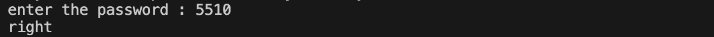
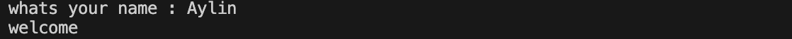
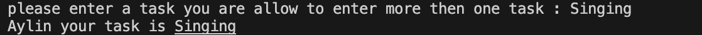
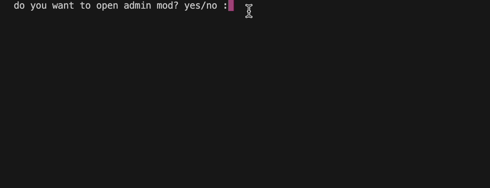

# 🌸 Personal Task Mannager 🌸

## Description

  _*This is a python project that it will ask the user to enter a task .*_

## Table Contents
- [Features](#features)
- [Project Structure](#project-structure)
- [File Description](#file-description)
- [Requirements](#requirements)
- [Installation](#installation)
- [Envirment Setup](#envirment-setup)
- [Usage](#usage)
- [Example Output](#example-output)
- [Screenshot](#screenshot)
- [Demo](#demo)
- [Author](#author)

## Feature

- Asking the user if they know the admin passwor yes/no
  
- Asking the user name

- Asking the user to enter a task 

## Project Structure
``` 
Personal_Task_Mannager\
|   .env
|   .env.example
|   .gitignore
|   app.log
|   error.log
|   main.py
|   README.md
|   requirements.txt
|   text.txt
└── tasks.py
```
## File Description
|File|Description|
|----|----|
|`main.py` | main.py it's the main file that  is main code in it | 
|`tasks.py` | tasks.py its a file that there is a question in it that say *pleas enter a task*|
|`Readme.md`|Readme.md is talking about how the project work and like what the Feature, File Description and the others |
|`tasks.txt`|Tasks.txt is the file that when you run the project it will show the terminal in a sentens|
|`error.log`|error.log there is nothing in it|
|`app.log`|app.log there is nothing in that file|
|`gitignore`|its the file that when you dont want someone to sea your stoff you put it there it will be ignore|
|`.env.example`|.env.example is a file that the paswoord is in it but not the one that is in .env|
|`.env`|.env is the file that it will keep the password|

## Requirements

The thing that you need to have is : 

- `Python 3`
- `python-dotenv`

## Installation

1. First thing is that you have to have python:
```
python --version
```
2. Second thing is that you need to have python pachages

```
pip install -r requirments.txt
```

## Envirment Setup

### First make a .env.example file and after make a .env file

```
.env.example
.env
```
### replace the thing inside of the variable in .env.examaple woth the real thing in .env
   
```
Replace

TASK_MANAGER_ADMIN_PASSWORD=your_password_here

with like some number inside of TASK_MANAGER_ADMIN_PASSWORD
```

## Usage
1. you run the code
2. you will get massage that it say do you want admin mode on or off yes/no?
3. if it was yes ask the password athat is in .env and if it was not go to the next step
4. next stepwhats your name 
5. next step write a task
6. and at the end it will say your name and the task thatyou type

## Example Output
```
do you want to open admin mod? yes/no :yes
enter the password : 5510
right
whats your name : Aylin
welcome
please enter a task you are allow to enter more then one task : singing
Aylin your task is singing
```
## Screenshot

#### start game


#### asking about password


#### asking the user abouther name



#### asking the user about what task does user want



## Demo




## Roadmap

- [x] ask for the task 
- [x] ask for the name
- [x] ask for the admin mode


## Contributing

## License

## Author

creat by [Aylin Sadeghi]()
